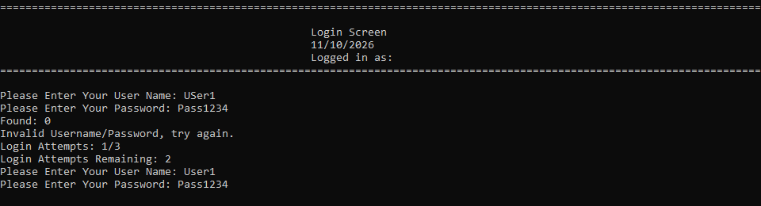
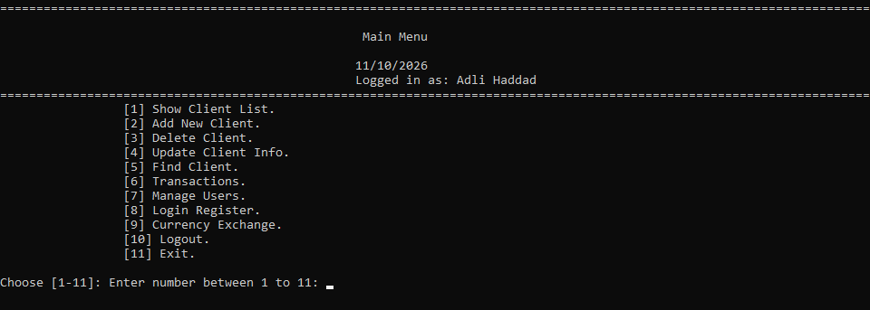
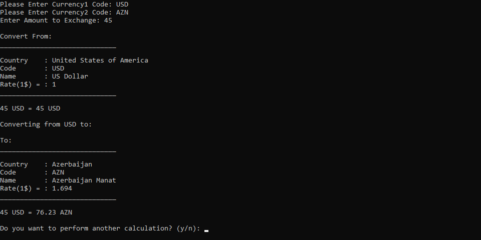

# Bank Management System & Currency Exchange 🏦💱

A console-based banking and currency exchange system written in C++.
I built it after learning object-oriented programming, to practise classes,
inheritance, encapsulation, file handling and design patterns. It was
challenging, and I'm proud of it.

## Screenshots

## Features
- 🔐 Login system with password obfuscation (Caesar cipher, see Security Note)
- 👥 Client management: add, delete, update, find, list
- 💰 Transactions: deposit, withdraw, transfer (with logging)
- 👤 User management with role-based permissions (bitmasks)
- 📋 Audit logs: login register and transfer log
- 💱 Currency exchange: list, find, update rates, calculator

## How to Run
Requires Windows and Visual Studio 2022 with the
**Desktop development with C++** workload (this includes the Windows SDK).

1. Clone the repository.
2. Open `BankProjectPremium.vcxproj` in Visual Studio.
3. Build and run (Ctrl+F5).
4. Log in with one of the demo accounts below.

**Important:** the `.txt` data files (`Users.txt`, `Clients.txt`,
`Currencies.txt`, `LoginRegister.txt`, `TransferLog.txt`) must be in the
folder the program runs from. With Ctrl+F5 this is the project folder.
If you run the `.exe` from another folder, copy the files next to it.

## Demo Accounts
These are test accounts only, not real credentials.

| Username | Password |
|----------|----------|
| User1    | Pass1234 |
| User2    | Pass1234 |
| User3    | Pass1234 |
| User4    | Pass1234 |
| User5    | Word5555 |
| User6    | Bank4323 |

## Security Note
Passwords are stored with a Caesar cipher to practise encryption logic.
This is **not secure**: it only shifts letters, so it can be reversed in
seconds. A real system would use salted password hashing (for example
bcrypt or Argon2). I'm aware of this limitation and plan to learn proper
hashing.

## Tech Stack
- Language: C++
- IDE: Visual Studio 2022
- Storage: text files (.txt)

## What I Learned
- Object-oriented programming: inheritance and encapsulation
- File handling in C++
- Design patterns (Factory method)
- Permission systems using bitmasks
- Caesar cipher and why it is not real security
- Currency conversion logic

## Possible Improvements
- Replace the Caesar cipher with proper password hashing
- Stop writing passwords to the login log
- Hide the password while typing
- Replace text files with a database (e.g. SQLite)
- Add unit tests
